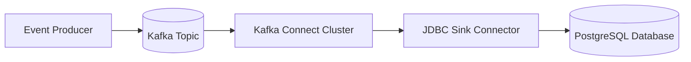
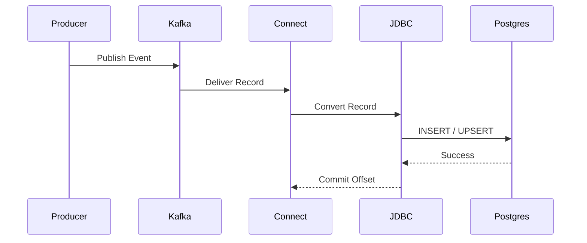

# Event-Driven Data Integration Architecture

## Kafka → PostgreSQL using IBM Event Streams and Kafka Connect

---

# 1. Executive Summary

This document describes the architecture and implementation of a simple but production-relevant **event-driven data integration pipeline** built using:

* **IBM Event Streams (Apache Kafka)**
* **Kafka Connect**
* **JDBC Sink Connector**
* **PostgreSQL**

The pipeline consumes structured events from a Kafka topic and writes them to a relational database table using **idempotent upsert operations**.

This pattern enables organizations to:

* Persist event streams into operational data stores
* Build queryable projections of event data
* Integrate streaming systems with legacy relational infrastructure
* Maintain consistent system state across services

---

# 2. Architecture Overview

## Logical Architecture



---

## Data Processing Flow



---

# 3. Core Components

## Event Producer

The producer application publishes events to Kafka using secure authentication.

Responsibilities:

* Serialize event data
* Authenticate with Kafka
* Publish to target topic

---

## Kafka Topic

The Kafka topic acts as the **durable event log**.

Key benefits:

* Decouples producers and consumers
* Provides replay capability
* Enables horizontal scalability

---

## Kafka Connect Cluster

Kafka Connect is the **integration runtime** responsible for moving data between Kafka and external systems.

Responsibilities:

* Consume messages from Kafka topics
* Transform records into structured data
* Invoke connector plugins

Kafka Connect runs as a **distributed worker cluster**.

---

## JDBC Sink Connector

The JDBC Sink Connector translates Kafka records into SQL operations.

Capabilities:

* Insert new records
* Update existing records
* Map record fields to database columns

This connector enables reliable integration between streaming systems and relational databases.

---

## PostgreSQL Database

PostgreSQL acts as the persistent relational storage layer.

Responsibilities:

* Store structured event data
* Support downstream reporting or querying
* Provide transactional consistency

---

# 4. Deployment Environment

The architecture assumes deployment in **OpenShift / Kubernetes** using IBM Event Streams.

Components include:

| Component         | Platform                      |
| ----------------- | ----------------------------- |
| Kafka Cluster     | IBM Event Streams             |
| Kafka Connect     | Custom container image        |
| Connector Plugins | JDBC + PostgreSQL driver      |
| Database          | PostgreSQL (Crunchy Operator) |

---

# 5. Database Setup

## Create Database

```sql
CREATE DATABASE pnames;
```

Connect to the database:

```sql
\c pnames
```

---

## Create Table

```sql
CREATE TABLE public.test_events (
    id INTEGER PRIMARY KEY,
    name VARCHAR(100),
    description VARCHAR(255),
    amount DOUBLE PRECISION,
    quantity INTEGER,
    active BOOLEAN
);
```

---

## Grant Permissions

The connector user must have write access.

```sql
ALTER TABLE public.test_events OWNER TO app;
```

---

# 6. Kafka Connect Image

Kafka Connect requires connector plugins to be available in its plugin path.

Required components:

* JDBC Sink Connector
* PostgreSQL JDBC Driver

---

## Dockerfile

```dockerfile
FROM icr.io/cpopen/ibm-eventstreams-kafka-connect:latest

USER root

RUN mkdir -p /opt/kafka/plugins/jdbc

COPY jdbc-connector-for-apache-kafka-6.10.0.jar /opt/kafka/plugins/jdbc/
COPY postgresql-42.7.10.jar /opt/kafka/plugins/jdbc/

USER 1001
```

---

## Build and Push

```bash
docker build -t quay.io/danutek_us/kc1:4 .
docker push quay.io/danutek_us/kc1:4
```

---

# 7. Kafka Connect Deployment

Kafka Connect is deployed as a Kubernetes custom resource.

```yaml
apiVersion: eventstreams.ibm.com/v1beta2
kind: KafkaConnect
metadata:
  name: kc
  namespace: kafka
  annotations:
    eventstreams.ibm.com/use-connector-resources: "true"

spec:
  replicas: 1
  image: quay.io/danutek_us/kc1:4

  bootstrapServers: kafka-es-kafka-bootstrap.kafka.svc:9093

  authentication:
    type: scram-sha-512
    username: danutek
    passwordSecret:
      secretName: danutek
      password: password

  tls:
    trustedCertificates:
      - secretName: kafka-es-cluster-ca-cert
        certificate: ca.crt

  config:

    group.id: connect-cluster

    config.storage.topic: connect-cluster-configs
    offset.storage.topic: connect-cluster-offsets
    status.storage.topic: connect-cluster-status

    config.storage.replication.factor: 1
    offset.storage.replication.factor: 1
    status.storage.replication.factor: 1

    key.converter: org.apache.kafka.connect.storage.StringConverter
    value.converter: org.apache.kafka.connect.json.JsonConverter
    value.converter.schemas.enable: "true"
```

Deploy using:

```bash
oc apply -f kafkaconnect.yaml
```

---

# 8. JDBC Sink Connector

```yaml
apiVersion: kafka.strimzi.io/v1beta2
kind: KafkaConnector
metadata:
  name: pnames-sink
  namespace: kafka
  labels:
    strimzi.io/cluster: kc

spec:
  class: io.confluent.connect.jdbc.JdbcSinkConnector
  tasksMax: 1

  config:

    topics: pnames

    connection.url: jdbc:postgresql://pg-primary.tej-project.svc:5432/pnames
    connection.user: app
    connection.password: <password>

    table.name.format: public.test_events

    insert.mode: upsert
    pk.mode: record_value
    pk.fields: id

    auto.create: false
    auto.evolve: false

    errors.tolerance: all
    errors.log.enable: true
```

Deploy:

```bash
oc apply -f pnames-sink.yaml
```

---

# 9. Security Configuration

Kafka access uses:

* **TLS encryption**
* **SCRAM-SHA-512 authentication**

Producer configuration:

```properties
bootstrap.servers=kafka-es-kafka-bootstrap.kafka.svc:9093
security.protocol=SASL_SSL

ssl.truststore.location=/path/es.p12
ssl.truststore.password=<password>

sasl.mechanism=SCRAM-SHA-512
sasl.jaas.config=org.apache.kafka.common.security.scram.ScramLoginModule required \
username="danutek" \
password="<password>";
```

---

# 10. Event Format

Because the worker uses:

```
value.converter.schemas.enable=true
```

events must include a **Kafka Connect schema envelope**.

Example message:

```json
{"schema":{"type":"struct","name":"test_events","fields":[{"field":"id","type":"int32"},{"field":"name","type":"string","optional":true},{"field":"description","type":"string","optional":true},{"field":"amount","type":"double","optional":true},{"field":"quantity","type":"int32","optional":true},{"field":"active","type":"boolean","optional":true}]},"payload":{"id":13,"name":"OrderA","description":"First","amount":125.5,"quantity":10,"active":true}}
```

---

# 11. Data Persistence Model

Connector configuration uses:

```
insert.mode = upsert
pk.mode = record_value
pk.fields = id
```

Resulting SQL:

```sql
INSERT INTO public.test_events (...)
VALUES (...)
ON CONFLICT (id)
DO UPDATE SET ...
```

This ensures:

* Idempotent event processing
* Safe retries
* Event replay compatibility

---

# 12. Operational Considerations

## Error Handling

Connector configuration includes:

```
errors.tolerance=all
errors.log.enable=true
```

Recommended improvement:

```
errors.deadletterqueue.topic.name=<dlq-topic>
```

---

## Scaling

Kafka Connect can scale horizontally.

Each connector task processes partitions independently.

---

## Monitoring

Recommended monitoring sources:

* Kafka Connect REST API
* Event Streams metrics
* Connector task logs

---

# 13. Common Troubleshooting

### JDBC Driver Missing

Error:

```
No suitable driver found
```

Fix:

Place both jars in the same plugin directory.

```
/opt/kafka/plugins/jdbc/
```

---

### Missing Schema

Error:

```
record value schema is missing
```

Cause: message lacks schema envelope.

---

### Invalid Schema Type

Error:

```
Unknown schema type: float64
```

Fix:

```
double
```

---

### PostgreSQL Permission Error

Fix:

```sql
ALTER TABLE public.test_events OWNER TO app;
```

---

# 14. Future Enhancements

Recommended improvements for production systems:

### Schema Registry

Use **Apicurio Registry** to manage schemas externally.

Benefits:

* Schema evolution
* Compatibility enforcement
* Simplified message format

---

### Dead Letter Queues

Capture problematic events without stopping the connector.

---

### Change Data Capture

Integrate **Debezium** to stream database changes back into Kafka.

---

### Observability

Add monitoring with:

* Prometheus
* Grafana
* OpenShift monitoring

---

# 15. Conclusion

This architecture demonstrates a robust integration pattern between **event streaming systems and relational databases**.

Key characteristics:

* Reliable
* Idempotent
* Secure
* Extensible

This design provides a foundation for building **event-driven data platforms** using Kafka and relational systems.
