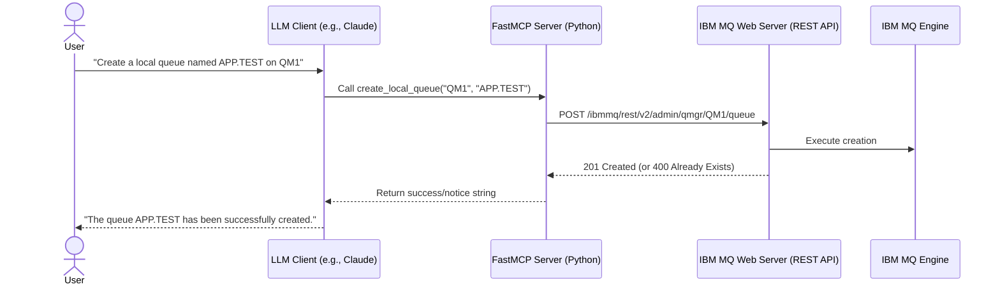

# Architecture: IBM MQ MCP Server

## System Context

This server acts as a secure execution bridge between a Large Language Model (LLM) and your IBM MQ estate. It uses the Model Context Protocol (MCP) to expose IBM MQ REST API operations as callable tools for the AI.



## Component Architecture

```
┌─────────────────────────────────────────────────────────────┐
│                        User Layer                            │
│  (Natural Language Interface via Claude Desktop, etc.)       │
└──────────────────────────┬──────────────────────────────────┘
                           │ MCP Protocol (stdio/JSON-RPC)
┌──────────────────────────▼──────────────────────────────────┐
│                   FastMCP Framework                          │
│  • Tool Registration & Discovery                             │
│  • Type Validation from Docstrings                           │
│  • JSON-RPC Message Handling                                 │
└──────────────────────────┬──────────────────────────────────┘
                           │
┌──────────────────────────▼──────────────────────────────────┐
│              MQ MCP Server (mq_mcp_server.py)                │
│                                                              │
│  ┌────────────────────────────────────────────────────┐    │
│  │           Tool Categories (30+ tools)               │    │
│  │                                                      │    │
│  │  • Queue Management (15 tools)                      │    │
│  │    - CRUD operations for all queue types            │    │
│  │    - Status monitoring and depth tracking           │    │
│  │                                                      │    │
│  │  • RDQM/HA Monitoring (3 tools)                     │    │
│  │    - Individual QM HA status                        │    │
│  │    - Estate-wide health checks                      │    │
│  │    - Threshold-based alerting                       │    │
│  │                                                      │    │
│  │  • Channel Management (3 tools)                     │    │
│  │    - Channel listing and status                     │    │
│  │                                                      │    │
│  │  • Queue Manager Ops (2 tools)                      │    │
│  │    - QM status and listing                          │    │
│  │                                                      │    │
│  │  • Batch Operations (2 tools)                       │    │
│  │    - Config comparison and export                   │    │
│  └────────────────────────────────────────────────────┘    │
│                                                              │
│  ┌────────────────────────────────────────────────────┐    │
│  │              Helper Functions                       │    │
│  │                                                      │    │
│  │  • get_mq_config() - Environment variable loading   │    │
│  │  • get_base_url() - URL construction                │    │
│  │  • get_headers() - CSRF token handling              │    │
│  │  • handle_mq_response() - Response normalization    │    │
│  │  • check_queue_exists() - Idempotency support       │    │
│  └────────────────────────────────────────────────────┘    │
└──────────────────────────┬──────────────────────────────────┘
                           │ HTTPS/REST (httpx.AsyncClient)
┌──────────────────────────▼──────────────────────────────────┐
│              IBM MQ Web Server (mqweb)                       │
│  • REST API Endpoint (:9443/ibmmq/rest/v2/admin)            │
│  • Authentication (Basic Auth / LTPA Tokens)                 │
│  • Authorization (MQ Authorities)                            │
│  • CSRF Protection                                           │
└──────────────────────────┬──────────────────────────────────┘
                           │ Internal MQ Commands
┌──────────────────────────▼──────────────────────────────────┐
│                 IBM MQ Queue Managers                        │
│  • QM1, QM2, QM3... (Local or RDQM HA)                      │
│  • Queues, Channels, Listeners                               │
│  • Pacemaker/DRBD (for RDQM)                                 │
└──────────────────────────────────────────────────────────────┘
```

## Core Architectural Principles

When extending this server or reviewing pull requests, the following principles are non-negotiable.

### 1. Strict Idempotency (The Golden Rule for AI)
LLMs are non-deterministic. They may call the same tool twice, or retry a tool if they misunderstand a network timeout response. **Every state-changing tool (`POST`, `PATCH`, `DELETE`) must be idempotent.**

**Implementation Pattern:**
```python
@mcp.tool()
async def create_local_queue(qmgr_name: str, queue_name: str, ...) -> str:
    # Check if queue already exists (idempotency)
    if await check_queue_exists(qmgr_name, queue_name):
        return f"Notice: Queue {queue_name} already exists on {qmgr_name}."
    
    # Proceed with creation...
```

**Why This Matters:**
* If the AI tries to create a queue that already exists, catch the `MQRC_Q_ALREADY_EXISTS` error and return a safe `"Notice: Queue already exists"` string rather than failing.
* If the AI tries to delete a queue that is already gone, catch the `404 Not Found` error and return a success/notice.
* If a tool throws a hard error on a retry, the AI will assume the desired state was not reached and may attempt complex, destructive workarounds to fix a problem that doesn't exist.

### 2. Absolute Statelessness
The MCP server must never maintain a local database, cache, or state file of what it "thinks" the MQ estate looks like.

**The Single Source of Truth (SSOT):**
* The SSOT is always the IBM MQ Queue Manager itself, queried via REST API
* If the AI needs to know if an object exists, it must use a `GET` tool to check the MQ Web Server directly in real-time
* No caching of queue depths, channel statuses, or configuration data
* Every query returns fresh data from the live system

**Why This Matters:**
* MQ state can change outside the MCP server (manual changes, other applications)
* Stale cache data leads to incorrect decisions by the AI
* Real-time data ensures the AI always works with current reality

### 3. Docstrings are Execution Code
In standard software development, docstrings are for human developers. In an MCP architecture, **docstrings and type hints are the actual system prompts injected into the LLM's context window.**

**Critical Requirements:**
* The `@mcp.tool()` decorator parses the `Args:` block to teach the LLM exactly what variables to pass
* Every parameter must have a clear description with format expectations
* Optional parameters must state their default values
* Return value descriptions must specify the format (JSON vs plain text)

**Example of Good Docstring:**
```python
@mcp.tool()
async def create_local_queue(
    qmgr_name: str,
    queue_name: str,
    max_depth: int = 5000,
    desc: str = "Created via MCP"
) -> str:
    """
    Creates a new Local Queue on the specified IBM MQ Queue Manager.
    This operation is idempotent - if the queue already exists, it returns a notice.
    
    Args:
        qmgr_name: The name of the queue manager (e.g., 'QM1').
        queue_name: The name of the new queue to create.
        max_depth: Maximum message depth (defaults to 5000).
        desc: Description of the queue's purpose.
        
    Returns:
        Success message, notice if queue exists, or error message.
    """
```

**Why This Matters:**
* If a docstring is vague or missing, the LLM will hallucinate parameters
* Treat docstring updates with the exact same rigor as logic updates
* The LLM cannot "see" your code—only the docstring and type hints

### 4. Consistent Error Handling
All tools must return errors in a consistent, parseable format that the LLM can understand and act upon.

**Error Response Pattern:**
```python
# Success
return "Success: Queue APP.TEST created on QM1."

# Notice (idempotent operation)
return "Notice: Queue APP.TEST already exists on QM1."

# Error with context
return "Error 403: User mqadmin lacks +crt authority on QM1."
```

**Why This Matters:**
* The LLM uses the response to determine next actions
* Consistent patterns help the LLM learn and improve
* Clear error messages enable the LLM to explain issues to users

### 5. Type Safety Throughout
Every function must have complete type hints for all parameters and return values.

**Requirements:**
* Use `str`, `int`, `bool`, `Optional[str]`, etc.
* Import types from `typing` module
* FastMCP uses these for validation before calling your function

**Why This Matters:**
* Prevents runtime type errors
* Enables IDE autocomplete and static analysis
* FastMCP validates inputs before execution

## Data Flow Patterns

### Read Operations (GET)
```
User Query → LLM → MCP Tool → REST GET → MQ → JSON Response → LLM → User
```

**Characteristics:**
* No idempotency concerns
* Return full JSON for LLM parsing
* Fast and safe

### Write Operations (POST/PATCH/DELETE)
```
User Intent → LLM → MCP Tool → Idempotency Check → REST POST/PATCH/DELETE → MQ → Status → LLM → User
```

**Characteristics:**
* Must check for existing state
* Return clear success/notice/error messages
* Slower but safe

### Compound Operations
```
User Intent → LLM → MCP Tool → Multiple REST Calls → Aggregated Response → LLM → User
```

**Example:** `monitor_queue_depths` makes one REST call but processes multiple queues

**Characteristics:**
* Reduces LLM token usage
* Faster than sequential tool calls
* Provides higher-level insights

## Security Architecture

### Authentication Flow
```
MCP Server → Basic Auth (user:pass) → mqweb → MQ Authorities Check → Allow/Deny
```

**Current Implementation:**
* Basic Authentication with credentials from environment variables
* CSRF token set to "blank" for Basic Auth
* SSL verification disabled (verify=False) for development

**Production Requirements:**
* Enable SSL verification with proper CA certificates
* Consider LTPA token authentication for session management
* Rotate credentials regularly
* Use service accounts with minimal required authorities

### Authorization Model
The MCP server inherits the MQ user's authorities. Required authorities by operation type:

| Operation | Required Authority |
|-----------|-------------------|
| List queues | +dsp (display) |
| Get queue details | +dsp |
| Create queue | +crt (create) |
| Modify queue | +chg (change) |
| Delete queue | +dlt (delete) |
| Clear messages | +clr (clear) |

**Principle of Least Privilege:**
* Phase 1 (Read-Only): Only +dsp authority
* Phase 2 (Human-in-Loop): +dsp, +crt, +chg
* Phase 3 (Autonomous): Full authorities with scope restrictions

### Blast Radius Control
The MCP server's impact is limited by:

1. **MQ Authorities:** Cannot exceed the user's granted authorities
2. **Network Access:** Only reaches queue managers accessible from the server
3. **Tool Scope:** Only operations explicitly implemented as tools
4. **Idempotency:** Prevents accidental duplicate operations

## Performance Considerations

### Current Performance Profile
* **Tool Invocation Overhead:** ~50-100ms (FastMCP framework)
* **Network Latency:** ~10-50ms per REST call (depends on network)
* **SSL Handshake:** ~100-200ms per new connection
* **MQ Processing:** ~5-20ms per operation

### Optimization Strategies

#### 1. Connection Pooling (Future Enhancement)
**Current:** New `httpx.AsyncClient` per tool invocation
**Proposed:** Global connection pool initialized at startup

```python
# Future implementation
class MQConnectionPool:
    def __init__(self):
        self.client = httpx.AsyncClient(
            verify=False,
            timeout=30.0,
            limits=httpx.Limits(max_connections=10)
        )
    
    async def close(self):
        await self.client.aclose()

# Initialize once at server startup
pool = MQConnectionPool()
```

**Benefits:**
* Reduces SSL handshake overhead
* Reuses TCP connections
* Critical for Phase 3 batch operations

#### 2. Parallel Queries (Implemented)
Tools like `get_estate_qmgr_status` could be enhanced to query multiple queue managers in parallel:

```python
# Future enhancement
async def get_estate_qmgr_status_parallel(qmgr_list: List[str]) -> str:
    async with httpx.AsyncClient(verify=False) as client:
        tasks = [
            client.get(f"{base_url}/qmgr/{qm}/status", ...)
            for qm in qmgr_list
        ]
        responses = await asyncio.gather(*tasks)
    # Process responses...
```

#### 3. Response Caching (Carefully Considered)
**Not Recommended** for most operations due to statelessness principle, but could be used for:
* Queue manager list (cache for 60 seconds)
* Static configuration data (cache for 5 minutes)
* Must include cache invalidation on write operations

## Known Technical Debt & Future Roadmap

As this project scales from a read-only prototype to managing a large enterprise estate autonomously, the following architectural upgrades should be prioritized:

### High Priority

1. **HTTP Connection Pooling**
   * **Issue:** Every tool invocation opens and closes a new `httpx.AsyncClient` session
   * **Impact:** Unnecessary SSL/TCP handshake latency
   * **Solution:** Initialize a global connection pool on server startup
   * **Effort:** Medium (1-2 days)

2. **Robust Error Handling in Verification**
   * **Issue:** `check_queue_exists()` returns `False` on any exception
   * **Impact:** AI may assume queue is missing when it's actually an auth/network error
   * **Solution:** Raise explicit exceptions for network/auth failures
   * **Effort:** Low (4-8 hours)

3. **Token-Based Authentication (LTPA)**
   * **Issue:** Basic Auth with blank CSRF token is not production-ready
   * **Impact:** Security and session management limitations
   * **Solution:** Implement LTPA token flow via `/login` endpoint
   * **Effort:** Medium (2-3 days)

### Medium Priority

4. **Comprehensive Logging**
   * **Issue:** Limited visibility into tool execution
   * **Impact:** Difficult to debug issues or audit actions
   * **Solution:** Structured logging with correlation IDs
   * **Effort:** Medium (2-3 days)

5. **Rate Limiting**
   * **Issue:** No protection against runaway AI loops
   * **Impact:** Could overwhelm MQ REST API
   * **Solution:** Implement per-tool and global rate limits
   * **Effort:** Low (1 day)

6. **Metrics and Monitoring**
   * **Issue:** No visibility into tool usage patterns
   * **Impact:** Cannot optimize or detect anomalies
   * **Solution:** Export metrics to Prometheus/CloudWatch
   * **Effort:** Medium (2-3 days)

### Low Priority

7. **Configuration File Support**
   * **Issue:** All config via environment variables
   * **Impact:** Limited flexibility for complex setups
   * **Solution:** Support YAML/JSON config files
   * **Effort:** Low (1 day)

8. **Multi-Tenant Support**
   * **Issue:** Single set of credentials for all operations
   * **Impact:** Cannot support multiple users/teams
   * **Solution:** Per-user credential management
   * **Effort:** High (1-2 weeks)

## Testing Strategy

### Unit Testing
* Test each tool function independently
* Mock `httpx.AsyncClient` responses
* Verify idempotency logic
* Test error handling paths

### Integration Testing
* Test against real MQ queue manager
* Verify REST API interactions
* Test authentication flows
* Validate response parsing

### End-to-End Testing
* Test via MCP protocol with real LLM
* Verify natural language understanding
* Test compound workflows
* Validate error recovery

### Load Testing
* Simulate multiple concurrent tool invocations
* Test connection pool behavior
* Verify rate limiting
* Measure performance under load

## Deployment Patterns

### Development
```bash
# Local development with environment variables
export MQ_REST_HOST=localhost
export MQ_REST_PORT=9443
python mq_mcp_server.py
```

### Production (Docker)
```dockerfile
FROM python:3.11-slim
WORKDIR /app
COPY requirements.txt .
RUN pip install -r requirements.txt
COPY mq_mcp_server.py .
CMD ["python", "mq_mcp_server.py"]
```

### Production (Kubernetes)
```yaml
apiVersion: v1
kind: Secret
metadata:
  name: mq-credentials
type: Opaque
data:
  MQ_REST_USER: <base64>
  MQ_REST_PASS: <base64>
---
apiVersion: apps/v1
kind: Deployment
metadata:
  name: mq-mcp-server
spec:
  replicas: 2
  template:
    spec:
      containers:
      - name: mcp-server
        image: mq-mcp-server:latest
        envFrom:
        - secretRef:
            name: mq-credentials
```

## Conclusion

This architecture balances simplicity with robustness, enabling rapid development while maintaining the safety and reliability required for production infrastructure management. The stateless, idempotent design ensures that the AI can safely interact with critical MQ infrastructure without risk of cascading failures or inconsistent state.

As the project matures through the three phases outlined in VISION.md, the architecture will evolve to support more sophisticated use cases while maintaining these core principles.