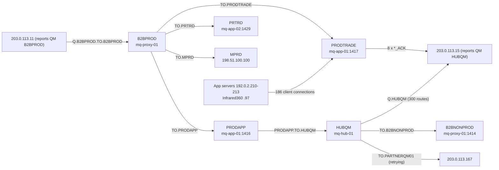

# IBM MQ — New Servers Assessment: mq-hub-01, mq-app-01, mq-proxy-01

> **Anonymized example.** Organization, partner, host, network and MQ identifiers are placeholders. Performance figures and technical observations are retained.

**Engagement:** ExampleCo DataStage, Db2 & IBM MQ Performance Assessment
**Scope:** Load, topology/design and open questions for three newly collected MQ hosts
**Queue managers analysed:** HUBQM (mq-hub-01), PRODTRADE (mq-app-01), B2BPROD (mq-proxy-01)
**Document reference:** `07_MQ_New_Servers_Assessment_mq-hub-01_mq-app-01_mq-proxy-01.md`

> **Reading convention.** Statements marked **[Fact]** are read directly from the collected files. Statements marked **[Inference]** are my interpretation and need ExampleCo confirmation. Statements marked **[Not verified]** could not be checked from the data supplied.

---

## 1. Executive Summary

All three hosts are **single-instance IBM MQ Advanced 9.3.0.37 queue managers on VMware RHEL 7.9 virtual machines with local LVM storage**. **[Fact]** There is no RDQM, no cluster software (corosync/pacemaker/drbd) and no MQ cluster on any of them. **[Fact]** Any availability they have comes from the platform underneath (VMware, SAN, backup), which the files do not show.

**Load.** None of the three was saturated in the 65-minute window (2026-11-09 08:25–09:30 CST). Log-disk write latency is low (p99 0.7–3.8 ms), memory is not under pressure, swap is nearly unused and TCP retransmits are negligible. **mq-app-01 is the busiest** (47.7% average CPU, run queue above the vCPU count in about 38% of samples) and has the least headroom of the three. mq-hub-01 shows the only large queue backlog (`Q.HUBQM` peaking at 61,466 messages), which drained each time. mq-proxy-01 is lightly loaded.

**Design.** The topology is a point-to-point sender/XMITQ mesh with a hub (HUBQM), with several queue managers sharing one host on two of the three servers. Linear logging with a pinned media-recovery LSN and no scheduled `rcdmqimg` means the log volumes grow until someone cleans them up. Three security/robustness settings need explanations: weak TLS enabled on two hosts, many channels with no CipherSpec, and `IgnoreSeqNumberMismatch=YES` on B2BPROD.

### 1.1 Scorecard

| Area | mq-app-01 (PRODTRADE) | mq-hub-01 (HUBQM) | mq-proxy-01 (B2BPROD) |
| :--- | :--- | :--- | :--- |
| Hardware | 6 vCPU / 31 GiB | 4 vCPU / 31 GiB | 4 vCPU / 16 GiB |
| CPU average busy / p99 / peak | 47.7% / 81% / 90% | 20.5% / 57% / 87% | 11.9% / 20% / 32% |
| Run queue above vCPU count | 1,479 samples (38%) | 507 samples | 47 samples |
| Log-disk write latency avg / p99 | 0.42 / 0.7 ms | 1.88 / 3.8 ms | 0.39 / 0.7 ms |
| Log-disk throughput | 17.7 MB/s | 20.6 MB/s | 12.5 MB/s |
| Network RX / TX average | 11.7 / 14.9 MB/s | 6.9 / 8.9 MB/s | 1.5 / 3.0 MB/s |
| Log extents created per minute | 28 | 38 | 19 |
| Queue backlog in window | Peak 9,027 (one queue) | Peak 61,466 (`Q.HUBQM`) | Peak 146 (PRTRD XMITQ) |
| Load verdict | Moderate–high, least headroom | Light CPU, bursty queue backlog | Light |
| Availability design | Single instance, 3 QMs on one host | Single instance, hub QM | Single instance, 2 QMs on one host |
| Weak TLS allowed in qm.ini | Yes | No | Yes |
| Error log reviewed | No (only in a zip) | Yes | Yes |

**Overall.** Performance is acceptable today. The risks are about **recovery and resilience** (single instance, no visible replication), **housekeeping** (log growth, FDC volume) and **security hygiene**, not capacity.

---

## 2. Scope, Data Sources and Limits

| Item | Detail |
| :--- | :--- |
| Collection window | 2026-11-09 08:25:07–09:30:07 CST: 3,900 one-second samples (sar/iostat) and 130 MQ polls at 30 s |
| Snapshot | runmqras / runmqsc at about 13:50–13:55 on the same day |
| Hosts | mq-app-01 192.0.2.245, mq-hub-01 192.0.2.244, mq-proxy-01 198.51.100.124 |
| Uptime | About 8 days 17–18 h on all three. Queue managers started 2026-10-31 around 16:03–16:08 |

**Limits that affect the conclusions**

1. **65-minute window.** It is one weekday morning. It is not proof of peak or end-of-day behaviour.
2. **Host-wide OS metrics.** On mq-app-01 (three QMs) and mq-proxy-01 (two QMs) CPU, memory, network and disk figures include every queue manager on the host.
3. **Not analysed.** PRODAPP and PRODLOG (mq-app-01) and B2BNONPROD (mq-proxy-01) have no runmqsc/defs data in the files. Their channels, queues and cluster membership are unknown.
4. **Error logs.** mq-hub-01 and mq-proxy-01 AMQERR01.LOG were analysed. The mq-app-01 log is inside a zip and was not extracted. AMQERR02/03.LOG exist on mq-proxy-01 but were not collected.
5. **LVM.** pbrun rejected the LVM commands, so mapping of device-mapper devices to logical volumes is **[Inference]**.
6. **Storage layer.** The files show virtual SCSI disks and local LVM. They do not show what the hypervisor or array does underneath (replication, snapshots).

---

## 3. Common Platform Profile (all three hosts)

| Setting | Value | Comment |
| :--- | :--- | :--- |
| OS | RHEL 7.9, kernel 3.10.0-1160.164.1, VMware | RHEL 7 standard maintenance ended June 2024 **[Inference: confirm ExampleCo's extended-support status]** |
| MQ | MQ Advanced 9.3.0.37 (`p930-037-260210`) | Installation3 `/apps/mqm9.3` primary, Installation1 `/apps/mqm9` also present |
| `mqconfig` | All PASS | Kernel/ulimit requirements for MQ are met |
| nofile | 10,240 soft = hard | Adequate for the observed 36–186 connections; limited headroom for 300–500 channels plus clients |
| Transparent Huge Pages | `[always]`, no tuned-adm | Commonly advised to be disabled for database-style workloads. Confirm whether this is ExampleCo standard. |
| TCP keepalive (sysctl) | time 7200 s, intvl 75, probes 9 | Dead peers can take over two hours to be detected at TCP level |
| `KeepAlive=YES` in qm.ini TCP stanza | Not present on any host | IBM states that TCP keepalive on distributed platforms requires `KEEPALIVE=YES` in the TCP stanza and must also be enabled in the OS |
| Other sysctl | somaxconn 128, tcp_max_syn_backlog 1280, netdev_max_backlog 1000, rmem/wmem_max 212992, swappiness 30 | mq-app-01 sees about 55 passive opens/s (peak 140/s) against a somaxconn of 128 |
| SELinux | Disabled | |
| qm.ini TCP buffer sizes | All 0 (OS default) | |
| Logging | LINEAR, `LogWriteIntegrity=TripleWrite`, `LogFilePages=4096` (16 MB extents) | TripleWrite is IBM's default; SingleWrite is only advised if the device guarantees 4 KB atomic writes |
| Image schedule | `IMGSCHED(MANUAL)`, `IMGINTVL` 60 | No automatic media images |
| MEDIALOG | Pinned on every QM (see per-host sections) | Old extents cannot be released until a media image is recorded |
| Monitoring attrs | MONCHL/MONQ/STATCHL/STATQ/ACCTQ all OFF | Limits what MQ itself can tell you about channel/queue activity |
| Security baseline | CHLAUTH ENABLED, CMDLEVEL 930, MAXMSGL 4,194,304 | |
| Channel heartbeat | SVRCONN/CLNTCONN HBINT 300 (`CLIENT.TO.*` SVRCONN 7500), KAINT AUTO, SHARECNV 10, MAXINST unlimited | On non-z/OS platforms IBM states KAINT is only stored and forwarded, so HBINT is the mechanism that applies |
| Client reconnect | CLNTCONN `RECONNECT` not set, `DEFRECON` NO | Applications will not reconnect automatically unless coded to |
| `/var/log/audit` | 62–66% full | |
| Clustering | None. `DIS CLUSQMGR` returns not found, REPOS blank | On mq-app-01 the QMGR record shows one CLUSSDR and one CLUSRCVR name, but without any active clustering these are probably defaults **[Inference]** |
| RDQM | Not installed (AMQ8250I). `STANDBY(NOPERMIT)`, `ROLE(Not configured)` | |

---

## 4. mq-app-01 — PRODTRADE (192.0.2.245)

### 4.1 Profile

* Hosts three queue managers: **PRODTRADE** (default, port 1417), **PRODAPP** (1416) and **PRODLOG** (1415). Only PRODTRADE has runmqsc and defs data.
* 6 vCPU, 31 GiB RAM.
* Role **[Inference]**: trade-message processing. Application servers 192.0.2.210–213 hold most of the 186 connections (`QueueMonitorLRPController` 95, `TradeRouterLRPController`, `TradeProcessorLRPController`), plus Infrared360 from 192.0.2.97.

### 4.2 Load and performance

| Metric | Result | Assessment |
| :--- | :--- | :--- |
| CPU busy | Avg 47.7% (user 17.9%, system 26.8%), p99 81%, peak 90% | Highest of the three. System time is higher than user time, which points at kernel/network work (many short connections, context switching) rather than application CPU **[Inference]**. |
| Context switches | 146k/s | High |
| Run queue | Avg 5.7, peak 38; above 6 vCPU in 1,479 samples | The CPU is queuing during bursts although average busy looks moderate |
| %iowait | Avg 3.0% | Not a constraint |
| Top processes | `amqrmppa` (PRODTRADE) about 17–20% CPU each at 08:25 | Channel-pool processes are the main consumer |
| Memory / swap | Free + cache never below 93%, about 6 MB swap | Healthy |
| Network | RX avg 11.7 MB/s (peak 275), TX avg 14.9 MB/s (peak 78), passive opens 55/s (peak 140/s), retransmits 0.0010% | Connection churn is high. Network is clean. |
| Log disk `dm-2` | 17.7 MB/s, 909 writes/s, 29% util (max 70%), w_await avg 0.42 ms (p99 0.7, max 1.8) | Good latency, comfortable headroom |
| Data disk `sdh` (PRODAPP data **[Inference]**) | About 12 bursts above 100 MB/s roughly every 5 minutes, peak 970 MB/s at about 1 MB per I/O | Pattern is regular, so likely scheduled. Cause unknown. |

### 4.3 Logging and storage

* About 28 new extents/min in the window, but growth is concentrated after 08:00: 1,103 extents in the 08:00 hour, 1,331 at 09:00, then 980, 709, 626 and 724 (partial).
* 5,572 extents (87 GB) at 13:54 on a 799 GB volume (11% used).
* `LogPrimary` 15 / `LogSecondary` 15. MEDIALOG pinned at S5999443, oldest extent Nov 8 17:00, MEDIASZ 89,201 MB.
* LOGUTIL during polls was 6–17%.
* Archive target `archive-nfs-01:/mqlogarch` mounted at `/MQ/logarch` (NFSv3, 1.1 TB, 26% used). `/var/crash` and `/example/cmg` are also NFSv3.

### 4.4 MQ configuration and traffic

| Item | Observation |
| :--- | :--- |
| Limits | MaxChannels 300, MaxActiveChannels 200 |
| Connections | 186 connections, 181 handles in CONN_FULL |
| SVRCONN | 41 instances; 38 use `CLIENT.TO.PRODTRADE` with blank SSLCIPH; ADMIN uses TLS_RSA_WITH_AES_256_CBC_SHA256 |
| Queues | 167 local (120 non-SYSTEM); only 32 default to persistent; 14 remote queues, 13 pointing at HUBQM |
| Queue depth | Up to 55 queues non-empty at once. Highest: `TRADEVAL.MATCHED.E2.FROMEXCHANGE02.REGULAR.04` 9,027 and `...FROMEXCHANGE03` 8,886 at about 08:30, both 0 by 09:29. Most queues allow 5,000,000. The 5,000-deep test queues are the only ones near their limit (`EXCHANGE09.TEST.MESSAGES` 49/5000). |
| Outbound channels | 8 RUNNING `PRODTRADE.*_ACK` senders to 203.0.113.15:1414 (EXCHANGE01_ACK 2,744,469, EXCHANGE04_ACK 1,154,244, EXCHANGE05 335,051, EXCHANGE06 306,673, EXCHANGE07 234,234, EXCHANGE08 232,308, EXCHANGE09 137,362, EXCHANGE10 72,143 messages since start) |
| Inbound channel | RCVR `B2BPROD.TO.PRODTRADE` from mq-proxy-01, 11,545,091 messages |
| Stopped senders | 6 `TO.*` (EXCHANGE11, EXCHANGE03, EXCHANGE04, PARTNER02, EXCHANGE07_1, EXCHANGE05), 0 messages, some last started in 2023/2025 |
| Security (qm.ini) | `AllowTLSV1=Y`, `AllowWeakCipherSpec=TLS_RSA_WITH_AES_128_CBC_SHA` |

The exchange-facing `TO.*` senders (TO.EXCHANGE06, TO.EXCHANGE04, TO.EXCHANGE08, TO.EXCHANGE01, TO.EXCHANGE07 and others) were not in the RUNNING list, and I did not determine where exchange traffic physically flows. **[Not verified]**

### 4.5 FDCs and filesystem

* `ffstSummary`: 18,863 FDCs (639 in 2026): 10,594 XC338001 and 7,998 XC407051 (all in 2021).
* 10,622 FDC files (1,256 MB) in `/var/mqm/errors`. `/var` was 59% at 08:25 and 18% at 13:54, which means cleanup happened during the day.
* Last FDC 2026-11-09 13:25 from `mqcertck` (XC338001).

### 4.6 Findings

| # | Severity | Finding |
| :-: | :--- | :--- |
| P25-1 | **High** | Three queue managers share one 6 vCPU VM. A fault or maintenance on the host takes all three down together, and CPU headroom is the thinnest of the three servers. |
| P25-2 | Medium | Run queue exceeds vCPU count 38% of the time with 55 passive opens/s. Connection churn plus somaxconn 128 is a risk under spikes. |
| P25-3 | Medium | 38 of 41 client connections run without TLS (blank SSLCIPH), while TLS 1.0 and a weak cipher are allowed for others. |
| P25-4 | Medium | 87 GB of log extents retained since the oldest extent (Nov 8 17:00, about 21 h) with the media LSN pinned and a manual image schedule. |
| P25-5 | Low–Medium | Regular 970 MB/s read/write bursts on `sdh` with unknown cause. |
| P25-6 | Low | 6 stopped senders from 2023/2025 should be formally retired or documented. |

---

## 5. mq-hub-01 — HUBQM (192.0.2.244)

### 5.1 Profile

* One queue manager, **HUBQM** (default, listener `TCP.1414`, BACKLOG 100).
* 4 vCPU, 31 GiB RAM, 46 GB swap.
* Role **[Inference]**: a hub. 300 of 304 remote queues route through `QM.Q.HUBQM` over a single transmission queue `Q.HUBQM`, and 184 XMITQs exist (one per outbound partner).

### 5.2 Load and performance

| Metric | Result | Assessment |
| :--- | :--- | :--- |
| CPU busy | Avg 20.5% (user 7.0%, system 12.4%), p99 57%, peak 87% | Low average with spikes |
| Context switches | 43k/s | |
| Run queue | Avg 2.1, peak 19; above 4 vCPU in 507 samples | Queuing in short bursts |
| %iowait | Avg 1.1% | |
| Memory / swap | Free + cache never below 95%, about 1 MB swap | Healthy |
| Network | RX avg 6.9 MB/s (peak 24), TX avg 8.9 MB/s (peak 26), passive opens 0.8/s, retransmits 0.0001% | Clean |
| Log disk `dm-2`/`sdg` | 20.6 MB/s, about 81 writes/s, 6.8% util (max 48%), w_await avg 1.88 ms (p99 3.8, max 10.8) | Few, large writes. Latency is the highest of the three but still low. |
| Log LV | `mqddslogvg-mqddsloglv`, 1.5 TB across 8 disks, only `sdg` shows I/O **[Inference from inferred mapping]** | Striping is not helping throughput, which is not currently needed |
| Data disk `sdf`/`dm-12` | Avg 2.9 MB/s; 8 bursts above 20 MB/s (peak 97 MB/s), first at 08:31:03 | Cause unknown |

### 5.3 The hub queue `Q.HUBQM`

* Sender `HUBQM.Q.HUBQM`: BATCHSZ 500, BATCHINT 100, HBINT 60, to 203.0.113.15. It had sent 47,779,763 messages (about 115k batches) since the channel started on 2026-11-08 17:00:27.
* `Q.HUBQM` is persistent by default (`DEFPSIST(YES)`), `MAXDEPTH(999999999)`, `QDPHIEV` enabled.
* In the window the queue was non-empty in **73 of 130 polls**, peak **61,466** at 08:35:08 (28,339 at 08:31:07), above 5,000 in 21 polls (the last at 09:27:44, 7,700) and always drained to 0. Median non-zero depth was 3,891. UNCOM peaked at 7,216 and OPPROCS at 818.
* **Interpretation [Inference]:** the single sender channel is throughput-limited during bursts. The queue absorbs bursts rather than growing without limit. That is acceptable only while the downstream is healthy. If 203.0.113.15 stalls, all 300 routes back up at once, because they share this single transmission queue and a single channel.

### 5.4 MQ configuration and channels

| Item | Observation |
| :--- | :--- |
| Limits | MaxChannels 500, MaxActiveChannels 500, LogPrimary 75 / Secondary 75 |
| Connections | 42 handles (average 45 in polls, range 42–52) |
| SVRCONN | 12 instances; `CLIENT.TO.HUBQM`, `IR360.SVRCONN`, `MQMON.SVRCONN` have no SSLCIPH; ADMIN uses TLS_RSA_WITH_AES_256_CBC_SHA256 |
| Queues | 246 local (199 non-SYSTEM); 176 of those default to persistent. At 13:50 no non-SYSTEM queue had CURDEPTH above 0 |
| Sender definitions | 168 SDR: about 83 with a CipherSpec, 85 without |
| Channel state | RUNNING: `PARTNER_A.PROD.SDR` (75 msgs), `HUBQM.Q.HUBQM`. RETRYING: `HUBQM.TO.PARTNERQM01` (203.0.113.167:1414). 34 STOPPED senders with 0 messages |
| Inbound | RCVR `PRODAPP.TO.HUBQM` from mq-app-01 (59,209 messages since 06:02) |
| To mq-proxy-01 | `HUBQM.TO.B2BNONPROD` goes to mq-proxy-01:1414 (the B2BNONPROD queue manager) |
| Client definitions | CLNTCONN entries for HUBQM, PRODAPP, PRODLOG, PRODTRADE (mq-app-01 ports 1416/1415/1417) and `CLIENT.TO.PRODPUB` -> `mq-pub-01.example.com:1414` (host appears in no collected data) |
| Security (qm.ini) | SSL stanza has OCSP settings only; no AllowTLSV1 or AllowWeakCipherSpec |

### 5.5 Logging and storage

* About 38 extents/min. 7,573 extents (118 GB) at 13:50 on a 1.5 TB volume (8% used; 1% at 08:25).
* MEDIALOG pinned at S8044667, MEDIASZ 119,441 MB, oldest extent Nov 6 17:00.
* Hourly extents: 1,506 / 1,833 / 1,304 / 926 / 817 / 962 (partial).
* LOGUTIL 4–76% and LOGINUSE 1–127 extents during polls. Peak LOGINUSE of 127 is below the 150 primary+secondary count but shows bursts hold a large share of the active log.
* Filesystems at 13:50: `/var` 15%, `/var/log/audit` 62%, `/apps` 54%, `/` 69%, NFS `/MQ/logarch` 26%.

### 5.6 Error log (AMQERR01.LOG, 2026-11-05 09:44 to 11-09 13:50)

| Message | Count | Interpretation |
| :--- | :-: | :--- |
| AMQ9999E channel ended abnormally | 715 | 372 for `CLIENT.TO.HUBQM` from client `app-client-01` (192.0.2.180, AMQ9209E connection closed), 301 for `HUBQM.TO.PARTNERQM01` (AMQ9202E, about 72 per day, remote host not reachable), 39 for `PARTNER_A.PROD.SDR` |
| AMQ9526E sequence-number error | 26 | e.g. sequence 3196 sent when 195 expected. Together with 4 AMQ8023I resets, this suggests channels were reset to resynchronise **[Inference]**. |
| AMQ9506E / AMQ9514E / AMQ9558E / AMQ9213E | 26 / 3 / 1 / 15 | Message-confirmation, channel-config and communications errors |
| AMQ8077W | 2 | `servicenow` command authority |
| AMQ7467I/AMQ7468I | 5,986 pairs | Normal log-extent messages (the media LSN is pinned) |

### 5.7 FDCs

* `ffstSummary`: 4,588 rows (565 in 2026), mostly XC338001 (3,764) plus 467 CO618000, which includes a 2018 `cciInvalidDataReceived`.
* 3,771 FDC files in the errors directory, last changed Oct 31 16:07 (matches the restart).

### 5.8 Findings

| # | Severity | Finding |
| :-: | :--- | :--- |
| P24-1 | **High** | HUBQM is a single point of failure for a hub carrying 300 routes through one XMITQ and one sender channel. |
| P24-2 | Medium | Bursts to 61,466 queued messages on `Q.HUBQM`. The single channel sets the ceiling, and a persistent XMITQ turns every burst into log I/O. |
| P24-3 | Medium | `HUBQM.TO.PARTNERQM01` has been retrying with about 72 AMQ9202E errors per day. |
| P24-4 | Medium | 85 of 168 sender definitions and 3 SVRCONN channels have no CipherSpec. |
| P24-5 | Medium | 26 AMQ9526E sequence-number errors on `PARTNER_A.PROD.SDR` and the hub sender. |
| P24-6 | Low–Medium | 372 AMQ9209E from `app-client-01` suggests a client that opens and drops connections, or has a network/firewall issue. |
| P24-7 | Low | 34 stopped senders, 1.5 TB log volume with only one of 8 disks doing I/O. |

---

## 6. mq-proxy-01 — B2BPROD (198.51.100.124)

### 6.1 Profile

* Two queue managers: **B2BPROD** (port 1413) and **B2BNONPROD** (default, port 1414). Only B2BPROD has runmqsc, log and error-log data.
* 4 vCPU, 16 GiB RAM, 47 GB swap.
* Role **[Inference]**: B2B message routing. Receives from 203.0.113.11 and forwards to PRODTRADE and PRODAPP (mq-app-01), PRTRD (`mq-app-02`, 192.0.2.246:1429) and MPRD (198.51.100.100:1414).
* A Sterling-related Java process (`/apps/ssp/jre`, `-Xmx8192m`) also runs on the host, which means the 16 GiB is shared with it.

### 6.2 Load and performance

| Metric | Result | Assessment |
| :--- | :--- | :--- |
| CPU busy | Avg 11.9% (user 2.6%, system 4.1%), p99 20%, peak 32% | Light |
| Run queue | 47 samples above 4 vCPU | Negligible |
| %iowait | Avg 5.2%, peak 11% | Highest of the three, though low in absolute terms |
| Memory / swap | Free + cache never below 87%, about 14 MB swap | Healthy |
| Network | RX avg 1.5 MB/s (peak 5), TX avg 3.0 MB/s (peak 10), retransmits 0.0040% | Light. Retransmits are the highest of the three but still very low. |
| Log disk `dm-1`/`sdg` | 12.5 MB/s, 691 writes/s, 22% util (max 42%), w_await 0.39 ms (p99 0.7, max 1.0) | Good |
| Data disk `sdf`/`dm-12` | 0.13 MB/s, no bursts | Idle |
| Context switches | 20k/s | |

### 6.3 Logging and storage

* About 19 extents/min. 3,894 extents (61 GB) at 13:49. Hourly: 738 / 917 / 694 / 515 / 461 / 465.
* `LogPrimary` 7 / `LogSecondary` 6 (13 extents, 208 MB). LOGINUSE reached 64 in polls, well above the 13 primary+secondary count. With linear logging the active log is not bounded by those values, so this is expected rather than a fault **[Inference]**. LOGUTIL 17–47%.
* MEDIALOG pinned at S4721574 (dated Nov 8 09:40), MEDIASZ 62,251 MB.
* `/MQ/B2BPROD/log`: 105 GiB used at 13:49 (18%) against 46 GB at 08:25. About **44 GiB is not an active-log extent**; that gap was already there at 08:25 (46 GB used with about 114 extents), so it is not growth in the window. Contents are not identified. **[Not verified]**
* `/var/mqm/log/B2BPROD/` is presumably a link to `/MQ/B2BPROD/log`. **[Inference]**
* Local archive volume `/MQ/B2BPROD/logarch` (720 GB, 53% used). No NFS mounts appear in the files.

### 6.4 MQ configuration and channels

| Item | Observation |
| :--- | :--- |
| Limits | MaxChannels 200, MaxActiveChannels 200, `MAXUMSGS` 10,000 |
| Security (qm.ini) | `AllowTLSV13=TRUE`, `AllowTLSV1=Y`, `AllowWeakCipherSpec=TLS_RSA_WITH_AES_128_CBC_SHA` |
| Unusual setting | **`IgnoreSeqNumberMismatch=YES`**. I could not find this in the IBM documentation search, so ExampleCo must explain what it is for. Sequence-number mismatches are what the setting suppresses, which removes a safety check against duplicated or lost messages. **[Inference]** |
| Connections | 36: 7 `Infrared360` on `ADMIN.B2BPROD` from 192.0.2.97, plus MQ processes and senders |
| RUNNING senders | `B2BPROD.TO.PRTRD` (11,724,139 msgs), `B2BPROD.TO.PRODTRADE` (11,380,238), `B2BPROD.TO.MPRD` (342,588), `B2BPROD.TO.PRODAPP` (258,445) |
| Inbound | RCVR `Q.B2BPROD.TO.B2BPROD` from 203.0.113.11 (reports remote QM name B2BPROD), 11,981,274 msgs |
| Receivers | 133 RCVR definitions, 55 with a CipherSpec and 76 without |
| Stopped | 4 senders (PARTNER03, PARTNER04, PARTNER05, PARTNER06), 0 messages, last started 2025-08-12 |
| SVRCONN | 7: ADMIN (TLS_RSA_WITH_AES_256_CBC_SHA256), `CLIENT.TO.B2BPROD` and `MQMON.SVRCONN` (no cipher) |
| CLNTCONN | `CLIENT.TO.B2BPROD` -> `mq-prod-alias(1413)`, `CLIENT.TO.B2BTEST` -> `mq-test-alias(1425)`. Neither name matches this host (`mq-proxy-01`). |
| Queues | 83 local (36 non-SYSTEM), 146 remote (86 to MPRD, 30 to PRODTRADE, 17 to PRODAPP, 4 to PARTNER06), 212 aliases |
| CHLAUTH | 100 rules, 91 are QMGRMAP |
| Depths | `EXCHANGE13.TEST` 11,161 (2.2% of 500,000), `TEST.EXCHANGE07`/`TEST.EXCHANGE07_2` 569 (11% of 5,000), `BUATDDS.TMP` 24. Test queues hold residual messages and have no consumers (IPPROCS 0). |
| PRTRD XMITQ | Non-empty in 55 of 130 polls, peak 146 at 08:44:39 |

### 6.5 Error log (AMQERR01.LOG, 2026-11-05 14:55 to 11-09 13:50)

* 29 AMQ9544W, all on `B2BPROD.TO.MPRD`: the remote QM could not put messages to the destination queue and tried its dead-letter queue.
* 4 AMQ8077W (`servicenow`). 10 each of AMQ9001I/9002I/9299I/9545I. 9,924 AMQ7467I/AMQ7468I. 1 AMQ7234I (10,000 messages loaded to `EXCHANGE13.TEST`).
* **Little noise** compared with mq-hub-01.

### 6.6 FDCs

* `ffstSummary`: 6,380 (405 in 2026): 5,670 XC338001 and 443 CO618000.
* 5,704 FDC files (549 MB), `/var` 34%.

### 6.7 Findings

| # | Severity | Finding |
| :-: | :--- | :--- |
| PX-1 | **High** | `IgnoreSeqNumberMismatch=YES` on a queue manager carrying about 11.7 million messages on each of its main routes. |
| PX-2 | **High** | Single instance feeding PRODTRADE, PRODAPP, PRTRD and MPRD. A failure stops all flows. |
| PX-3 | Medium | Unexplained 44 GiB on `/MQ/B2BPROD/log`. |
| PX-4 | Medium | 76 of 133 receiver definitions have no CipherSpec, while TLS 1.0 and a weak cipher are permitted. |
| PX-5 | Medium | 29 AMQ9544W: messages are going to a remote DLQ on `B2BPROD.TO.MPRD`. These are application-visible failures that nobody may be looking at. |
| PX-6 | Low–Medium | B2BNONPROD shares the host with no data supplied. 16 GiB is shared with the Java process. |
| PX-7 | Low | CLNTCONN names point at hosts that do not match this server. |

---

## 7. Topology and Design Assessment

### 7.1 Observed message flow

* The flow into PRODTRADE (about 11.4 million messages from B2BPROD) comes through a single channel.
* **Same-name counterparts [Inference].** 203.0.113.15 reports its QM name as HUBQM and 203.0.113.11 reports B2BPROD, the same names as the local queue managers. That suggests mirrored queue managers at another site, or NAT in front of these hosts. The address ranges are unexplained. mq-hub-01 is both a sender to 203.0.113.15 and the place where inbound traffic from PRODAPP arrives, so I cannot say which is primary.

### 7.2 Strengths

* No performance hot spots in the window: low disk latency, no memory pressure, clean network.
* Consistent build across all hosts (same MQ fix pack, same qm.ini baseline, `mqconfig` all PASS).
* CHLAUTH enabled and ADMIN channels use TLS 1.2 (AES-256 / SHA-256).
* Point-to-point channels isolate partners from each other in the common case; stopped partners do not block others.
* Persistent logging with TripleWrite gives strong integrity on virtual SCSI disks.
* Log volumes have large free capacity (82–92% free at 13:50).

### 7.3 Design concerns

| # | Concern | Evidence | Why it matters |
| :-: | :--- | :--- | :--- |
| D1 | **Single-instance queue managers** | No RDQM, no multi-instance, no cluster, local LVM | A host or VM failure means an outage until restart elsewhere. Recovery depends on VMware HA and the storage layer, **which the files do not show**. |
| D2 | **Co-hosted queue managers** | 3 on mq-app-01, 2 on mq-proxy-01 | Shared CPU, memory, disk and failure domain. Metrics cannot be attributed to one QM. |
| D3 | **Hub concentration** | 300 of 304 remote queues on HUBQM via one XMITQ and one channel | A stall of the hub channel blocks all of them (head-of-line blocking). |
| D4 | **Point-to-point mesh** | 184 XMITQs on mq-hub-01, 168 sender definitions, 133 receiver definitions on mq-proxy-01 | Operationally heavy, many stale definitions (34 + 6 + 4 stopped senders). |
| D5 | **Log lifecycle** | Linear logs, MEDIALOG pinned, IMGSCHED MANUAL, oldest extent 1–3 days old | IBM states `rcdmqimg` does not run automatically. Without it extents accumulate: 87 GB, 118 GB and 61 GB on the three hosts, retained over roughly 1–3 days. Volumes have space for now. |
| D6 | **Persistent hub traffic** | `Q.HUBQM` persistent by default, 176 of 199 queues persistent on mq-hub-01 | Most traffic is persistent, so log I/O scales with every message. |
| D7 | **Client connection design** | Single host per CLNTCONN, no `RECONNECT`, `DEFRECON` NO, `mq-pub-01` target absent from data | Clients cannot fail over to a second instance, even if one existed. |
| D8 | **Security posture** | 38 of 41 client connections on mq-app-01 unencrypted; 85/168 and 76/133 channel definitions without CipherSpec; TLS 1.0 plus weak cipher allowed; `IgnoreSeqNumberMismatch` | Mixed. Some plain-text paths may be intentional on an internal network, but they should be documented. |
| D9 | **Monitoring blind spots** | MONCHL/MONQ/STATCHL/STATQ/ACCTQ OFF | No MQ-side statistics for channel and queue usage. Backlogs like `Q.HUBQM` were found only by polling. |
| D10 | **Keepalive and connection handling** | TCP keepalive 7200 s, no `KeepAlive=YES`, HBINT 300 | Dead connections may linger. Partly offset by HBINT on message channels. |
| D11 | **FDC volume** | 18,863 / 4,588 / 6,380 FDCs in `ffstSummary` | Dominated by XC338001 (signal-handler / non-quiesced stop) and `mqcertck`; likely noise, but it conceals real FDCs. |

### 7.4 Availability statement

The evidence supports this statement and no stronger one: **each queue manager is single-instance on local storage, with no MQ-level HA or DR mechanism visible.** Single-instance status of PRODTRADE (and its siblings), HUBQM and B2BPROD has been confirmed by the customer contact. Whether VMware HA/vMotion, storage replication, or a standby site (possibly the same-name counterparts at 203.0.113.15 and 203.0.113.11) provide recovery cannot be determined from these files.

---

## 8. Cross-Cutting Findings

| # | Severity | Finding | Hosts |
| :-: | :--- | :--- | :--- |
| X1 | High | Single-instance QMs with no visible HA/DR; recovery design unknown | All |
| X2 | High | Pinned MEDIALOG with manual `rcdmqimg` and no cleanup evidence; 61–118 GB of extents each, retained over roughly 1–3 days | All |
| X3 | Medium | Weak TLS allowed (`AllowTLSV1=Y`, `AllowWeakCipherSpec`) | mq-app-01, mq-proxy-01 |
| X4 | Medium | Many channel definitions without a CipherSpec | All |
| X5 | Medium | THP `always`; keepalive 7200 s; `KeepAlive=YES` missing; nofile 10,240; somaxconn 128 | All |
| X6 | Medium | RHEL 7.9, standard maintenance ended June 2024 | All |
| X7 | Low–Medium | Very large FDC counts that bury real events | All |
| X8 | Low | `/var/log/audit` 62–66% | All |
| X9 | Low | Stale stopped senders, test queues with residual messages | All |
| X10 | Low | Monitoring/statistics attributes all OFF | All |

---

## 9. Recommendations (prioritised)

Items depending on an **[Inference]** need ExampleCo confirmation first.

**Immediate (days)**
1. Explain `IgnoreSeqNumberMismatch=YES` (B2BPROD) and the AMQ9526E errors on mq-hub-01. If no documented reason exists, plan to remove it in a test first.
2. Review the 29 AMQ9544W on `B2BPROD.TO.MPRD` and the retrying `HUBQM.TO.PARTNERQM01` with the owning teams.
3. Identify the 44 GiB of non-extent data on `/MQ/B2BPROD/log`.
4. Agree a log-lifecycle procedure: scheduled `rcdmqimg` (the IBM docs state it moves the media LSN forward and frees old log files) and a documented archive/cleanup step for old extents.

**Near term (weeks)**
5. Obtain the VMware HA/DRS, storage replication, backup and DR configuration behind these VMs, and document actual RTO/RPO.
6. Separate `Q.HUBQM` traffic into multiple XMITQs/channels, or raise throughput on the existing one, after studying what limits it (BATCHSZ 500 is already large; check the remote side).
7. Set `KeepAlive=YES` in the TCP stanza, shorten OS keepalive, and review somaxconn / tcp_max_syn_backlog on mq-app-01.
8. Decide the policy for TLS: remove TLS 1.0 and the weak cipher where nothing needs them, and document unencrypted channels as intentional or fix them.
9. Turn on basic statistics (e.g. STATCHL/MONCHL at low level) at least on the hub channels.

**Strategic**
10. Evaluate RDQM or multi-instance queue managers, or an agreed VMware-based recovery runbook, for HUBQM, B2BPROD and PRODTRADE.
11. Move the co-hosted QMs (PRODAPP/PRODLOG and B2BNONPROD) to separate hosts or document why they share one.
12. Plan RHEL upgrade (RHEL 8/9) and use the opportunity to standardise THP/tuned settings.
13. Add client reconnect (`RECONNECT`, CCDT with multiple instances) when a second instance exists.

---

## 10. Questions for the ExampleCo Team

### 10.1 Architecture and topology
1. What are 203.0.113.15 and 203.0.113.11? They report the same queue manager names as HUBQM and B2BPROD. Are they DR counterparts, NAT addresses, or another site?
2. Why does mq-app-01 send its eight `*_ACK` channels to 203.0.113.15 rather than to mq-hub-01 directly? Which side is primary?
3. Where does the exchange-facing traffic (the `TO.*` senders) flow on mq-app-01? Which channels are in service?
4. What are `mq-app-02` (PRTRD), 198.51.100.100 (MPRD) and `mq-pub-01` (`CLIENT.TO.PRODPUB`)? Can we have data from them?
5. What is the purpose of B2BNONPROD, PRODAPP and PRODLOG? Can we get their runmqsc and log data?
6. Why do the CLNTCONN entries on mq-proxy-01 reference `mq-prod-alias` and `mq-test-alias`?
7. Is a cluster intentionally absent? The mq-app-01 QMGR record lists a CLUSSDR/CLUSRCVR name; are those defaults?

### 10.2 Availability and recovery
8. What is the recovery plan if each VM is lost? Is VMware HA/vMotion in use? Is the storage replicated, and how?
9. What are the agreed RTO and RPO for each queue manager?
10. When was a restore or failover last tested? What caused the restart of all three on 2026-10-31 around 16:03–16:08?
11. How are queue manager data and logs backed up?

### 10.3 Logging and housekeeping
12. Who runs `rcdmqimg`, and when? Why is `IMGSCHED` MANUAL?
13. What process removes old log extents from `/var/mqm/log` and `/MQ/*/log`? Why is the oldest extent still from Nov 6/8?
14. What is using the extra 44 GiB on `/MQ/B2BPROD/log`?
15. What archives to `archive-nfs-01:/mqlogarch`, and how is retention managed? Why does mq-proxy-01 use a local archive volume?
16. Why are `LogPrimary`/`LogSecondary` set so differently (15/15, 75/75, 7/6)?
17. Why TripleWrite? Does the storage guarantee 4 KB write atomicity?
18. What cleans up `/var/mqm/errors`? mq-app-01 has 10,622 FDC files and `/var` dropped from 59% to 18% during the day.

### 10.4 Performance and workload
19. Is 2026-11-09 morning a representative load? What are the peak hours and the highest-volume days?
20. What drives the burst pattern on `Q.HUBQM` (peak 61,466)? Is the downstream able to consume faster?
21. What are the 970 MB/s bursts on mq-app-01 `sdh` every 5 minutes and the 97 MB/s bursts on mq-hub-01 `sdf`? Backups, scripts, application reports?
22. Why are three queue managers sharing a 6 vCPU VM on mq-app-01? Are CPU/memory reservations set in VMware?
23. What are the connection patterns: why 55 new TCP connections per second on mq-app-01?
24. Why is the largest log volume (1.5 TB, 8 disks) on mq-hub-01 using only one disk?

### 10.5 Errors and application behaviour
25. What explains the AMQ9526E sequence-number errors on `PARTNER_A.PROD.SDR` and `HUBQM.Q.HUBQM`?
26. Is `HUBQM.TO.PARTNERQM01` (203.0.113.167) expected to be down? Who owns it?
27. What is `app-client-01` (192.0.2.180) doing to generate 372 AMQ9209E?
28. Which application owns `B2BPROD.TO.MPRD`, and does anyone monitor the remote DLQ (29 AMQ9544W)?
29. What causes so many XC338001 FDCs, and why does `mqcertck` raise one on mq-app-01?
30. Why were 7,998 XC407051 FDCs raised in 2021 on mq-app-01?

### 10.6 Security and configuration
31. Why is `IgnoreSeqNumberMismatch=YES` set on B2BPROD?
32. Why are TLS 1.0 and `TLS_RSA_WITH_AES_128_CBC_SHA` allowed on mq-app-01 and mq-proxy-01?
33. Which channels are intentionally unencrypted (38 of 41 client connections on mq-app-01, 85/168 senders on mq-hub-01, 76/133 receivers on mq-proxy-01)?
34. Why is THP `always`, and is there an ExampleCo standard for sysctl tuning?
35. Is RHEL 7.9 on an extended-support contract, and what is the upgrade plan?
36. Why are the MONCHL/STATCHL/ACCTQ attributes all OFF?
37. Which of the 34 + 6 + 4 stopped senders can be deleted?
38. Why is the `/var/log/audit` filesystem at 62–66% on all three hosts?

---

## Appendix A. Source Files and Workbooks

| Host | Workbook | Builder |
| :--- | :--- | :--- |
| mq-app-01 | [`mq-app-01_Server_Load_Analysis.xlsx`](../../../working/mq-app-01_Server_Load_Analysis.xlsx) | [`build_mq-app-01_workbook.py`](../../../working/build_mq-app-01_workbook.py) |
| mq-hub-01 | [`mq-hub-01_Server_Load_Analysis.xlsx`](../../../working/mq-hub-01_Server_Load_Analysis.xlsx) | [`build_mq-hub-01_workbook.py`](../../../working/build_mq-hub-01_workbook.py) |
| mq-proxy-01 | [`mq-proxy-01_Server_Load_Analysis.xlsx`](../../../working/mq-proxy-01_Server_Load_Analysis.xlsx) | [`build_mq-proxy-01_workbook.py`](../../../working/build_mq-proxy-01_workbook.py) |

Raw inputs: `working/mq-app-01/`, `working/mq-hub-01/`, `working/mq-proxy-01/` (perf, os, mq, defs, ras).

## Appendix B. IBM Documentation Cited

IBM MQ documentation (`docs_ibm_mq`) was consulted for these points, and only these:
* TripleWrite is the default `LogWriteIntegrity`; SingleWrite should be used only if the device guarantees 4 KB write atomicity.
* `rcdmqimg` (linear logging only) records a media image, moves the media LSN forward and allows old log files to be archived or deleted. It is not run automatically. AMQ7467/AMQ7468 can also be issued at `rcdmqimg` time.
* On non-z/OS platforms, channel KAINT is only stored and forwarded, so HBINT is the effective heartbeat mechanism.
* TCP keepalive on distributed platforms needs `KEEPALIVE=YES` in the qm.ini TCP stanza and must also be enabled in the OS.
* Deprecated CipherSpecs are re-enabled only through `AllowWeakCipherSpec` in the qm.ini SSL stanza.
* No entry was found for `IgnoreSeqNumberMismatch`; its meaning is therefore not documented here.
